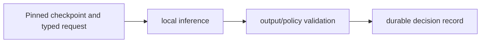

# Typed Decision Layer

**Local typed decisions, versioned policies and evidence-linked integration records.**

  [](LICENSE)

[Overview](#overview) · [Quickstart](#quickstart) · [Example](#example) · [Validation](#validation) · [Documentation](#documentation)

## Overview

A local decision integration layer with typed answers, versioned policies, evidence and persistent decision records.

**Stack:** Python · PyTorch · Transformers · safetensors · SQLite · TypeScript client · optional FastAPI/ONNX integrations

## Upstream engine and integration additions

| Component | Behavior |
| --- | --- |
| Upstream | The Laya engine and original notices are retained from its upstream project. |
| Integration | Typed answers, policy/evidence handling and ledger additions connect decisions to application state. |
| Runtime | Checkpoint revision and optional backend configuration define the local inference environment. |

## Processing path



## Quickstart

```console
python -m venv .venv
# Activate .venv, then:
python -m pip install -e .
python -m compileall -q laya tests
```

The commands above install prerequisites or run the specified offline checks. Live collection, cloud operations, messaging and trading are separate operational steps when present.

## Example

**Inspect the workflow**

Start with the [attribution notice](OMNIA_NOTICES.md), then inspect the additions in `examples/omnia/`, `tests/test_omnia*` and `docs/omnia/`. A pinned checkpoint, typed request, policy validation and persistent decision record form the intended integration boundary. Example code does not bundle model weights.

## Configuration and storage

The package declares optional backend/integration extras in [pyproject.toml](pyproject.toml). Select only the backend needed for your machine. GPU, ONNX and model-backed paths have separate prerequisites; the TypeScript client is in `laya-ts/`.

## Repository guide

| Location | Responsibility |
| --- | --- |
| [laya](laya) | Inherited engine and extensions |
| [examples/omnia](examples/omnia) | Integration examples |
| [docs/omnia](docs/omnia) | Integration documentation |
| [laya-ts](laya-ts) | TypeScript client |

## Validation

The quickstart lists the declared checks. No passing CI or coverage claim is implied by the technology badges.

## Scope and operational boundaries

This is an integration fork, not independently authored inference-engine code. Preserve upstream source, history and attribution. Historical benchmarks are not new measurements; checkpoint execution and optional backends need separate validation.

## Documentation

- [Fork attribution](OMNIA_NOTICES.md)
- [Development and validation](CONTRIBUTING.md)
- [Preserved upstream guide](UPSTREAM_README.md)

## License and attribution

See [LICENSE](LICENSE), [OMNIA_NOTICES.md](OMNIA_NOTICES.md).
