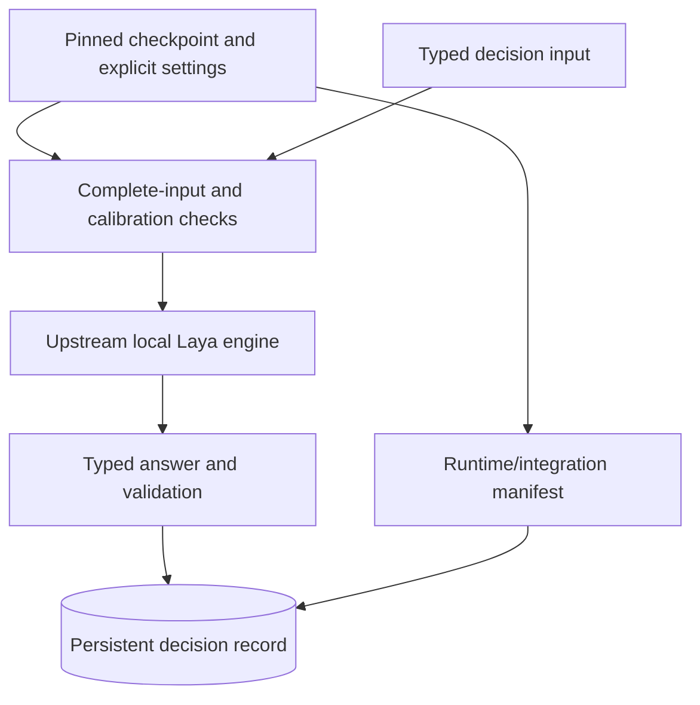

# Typed Decision Layer

  [](LICENSE)

A local decision integration layer around the upstream **Laya** engine, adding explicit checkpoint configuration, complete-input checks and persistent decision records.

This repository is a fork of [NandhaKishorM/laya](https://github.com/NandhaKishorM/laya). The inherited engine, TypeScript implementation and research material are not presented as original work in this fork. Original integration additions are identified in [OMNIA_NOTICES.md](OMNIA_NOTICES.md); the upstream landing document is retained in [UPSTREAM_README.md](UPSTREAM_README.md).

## What the integration adds

[examples/omnia/runtime.py](examples/omnia/runtime.py) requires an immutable 40-character checkpoint revision and validates model/device/thread/context limits. Importing the integration does not immediately load model weights.

Before inference, complete-input checks reject state, instruction or option content that would exceed the configured token budget. Calibration checks reject active temperature buckets that require review. Runtime and integration fingerprints are retained with configuration/dependency metadata for inspection.

[examples/omnia/ledger.py](examples/omnia/ledger.py) supplies durable decision records. These additions are separate from the upstream routing/inference implementation.



## Start with integration documentation

Read [docs/omnia](docs/omnia), the [integration examples](examples/omnia) and `tests/test_omnia*` before changing the inherited engine. The `Settings` model in [runtime.py](examples/omnia/runtime.py) defines the `OMNIA_LAYA_*` environment inputs; there is no root `.env.example` in this snapshot. PyTorch, Transformers, safetensors and optional serving/ONNX paths have different runtime requirements; model weights are distributed separately by their publishers.

The required source gates are:

```console
ruff check laya/ --select=E9,F63,F7,F82,F401,F811 --line-length=120
python -m compileall -q laya/ tests/
```

These gates passed in the recorded local review. They check lint/syntax, not inference quality, GPU performance or model parity. Checkpoint-backed tests require the selected weights/hardware. Preserve upstream Apache-2.0 notices and the model publisher's separate license when reusing the integration.

**Technology:** Python · PyTorch · Transformers · safetensors · SQLite · TypeScript client · optional FastAPI/ONNX integrations

Source license: [Apache-2.0](LICENSE). Existing upstream and third-party notices are retained.
