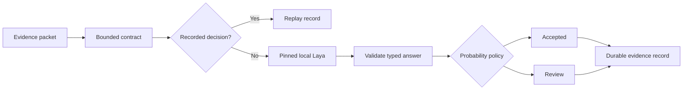

> Historical project notes. Paths, operational status, badges and test claims below are retained as archival reference and have not all been revalidated. Use the root README and docs/REVIEW.md for this review snapshot.

<p align="center">
  
</p>
<h1 align="center">OMNIA LAYA</h1>
<p align="center"><strong>Machine-native decisions. Evidence at every step.</strong></p>
<p align="center">
  A local decision layer for systems that need to know what happened, why it was accepted, and which evidence supports it.
</p>
<p align="center">
  <a href="#quickstart">Quickstart</a> ·
  <a href="#the-decision-path">Architecture</a> ·
  <a href="#engineering">Engineering</a> ·
  <a href="#research">Research</a> ·
  <a href="docs/omnia/OPERATIONS.md">Operations</a>
</p>
<p align="center">
  <a href="LICENSE"></a>
  <a href=".github/workflows/omnia.yml"></a>
</p>

---

OMNIA Laya turns typed model answers into durable, inspectable decision records.
It connects a pinned local checkpoint to the evidence, criteria and policy that
produced each result. Replay a request. Inspect its probabilities. Change a policy.
Keep the full decision lineage.

This is **OMNIA EYE's independent integration fork of [Laya](https://github.com/NandhaKishorM/laya)**.
The upstream engine supplies local `choice`, `score` and `noul` inference. OMNIA adds
complete-input checks, strict answer validation, probability gates, a persistent
ledger and evaluation tools. Original upstream code and attribution are preserved.

## The decision path



| Layer | What it provides |
| --- | --- |
| **Evidence** | Source identifiers, ordered criteria and a fingerprint of the exact request |
| **Inference** | An explicit checkpoint, immutable revision and local device configuration |
| **Validation** | Matching answer IDs, legal classes, finite probabilities and consistent scores |
| **Policy** | A configurable acceptance boundary with the exact questions requiring review |
| **Memory** | Durable replay across restarts, source-version fingerprints and recorded failure types |
| **Evaluation** | Accuracy, calibration, Brier score, coverage and error among accepted decisions |

## Quickstart

Clone the fork and install it into a Python 3.10+ environment with the appropriate
[PyTorch build](https://pytorch.org/get-started/locally/) for your device:

```bash
git clone https://github.com/Omniaeye/omnia-laya.git
cd omnia-laya
python -m pip install -e .
```

Select an immutable checkpoint revision. The following revision was used for the
[recorded local verification](docs/omnia/VALIDATION.md):

```bash
export OMNIA_LAYA_REVISION=55cf4c4ebb4ebe31b2550e8bdf3bd21b99753851
python -m examples.omnia --input examples/omnia/requests.jsonl
```

PowerShell:

```powershell
$env:OMNIA_LAYA_REVISION = '55cf4c4ebb4ebe31b2550e8bdf3bd21b99753851'
python -m examples.omnia --input examples/omnia/requests.jsonl
```

The first call loads the selected checkpoint. Repeat the command to retrieve the
same decisions from the local ledger. [Configuration](examples/omnia/.env.example)
and [operations](docs/omnia/OPERATIONS.md) cover model selection, context budgets,
private storage and offline operation.

## One record, complete lineage

Each response carries:

- `decision_id`, `source_id` and evidence references.
- Input and question fingerprints, including order-sensitive cache identity.
- Checkpoint revision, runtime source fingerprint and inference settings.
- Typed answers and their distributions.
- `accepted` or `review`, with question-level review reasons.
- Processing time, original decision timestamp and replay status.

Raw input text is kept out of the ledger. Failed processing produces an explicit
failure record and a retryable request. Content is never silently shortened to
fit a checkpoint: instruction, option and state budgets are checked before inference.

**Probability and confidence stay separate.** The policy uses answer probability;
upstream entropy-based confidence remains available as its own field. Thresholds
are chosen with reviewed task data, then versioned with every decision.

## Built for the OMNIA ecosystem

The same decision envelope supports different application-owned question sets:
news relevance, evidence matching, market observation review and data-quality routing.
The fork supplies the shared decision infrastructure; applications own their
publication rules, risk limits and authorized actions.

Explore the evidence field in
[OMNIA's multichain data stream](https://github.com/Omniaeye/data-stream-multichain).

## Engineering

| Component | Location |
| --- | --- |
| Typed contracts and durable ledger | [`examples/omnia/ledger.py`](examples/omnia/ledger.py) |
| Pinned inference and complete-input checks | [`examples/omnia/runtime.py`](examples/omnia/runtime.py) |
| Bounded JSONL processor | [`examples/omnia/__main__.py`](examples/omnia/__main__.py) |
| Calibration and coverage metrics | [`examples/omnia/evaluate.py`](examples/omnia/evaluate.py) |
| Automated checks | [`tests/test_omnia_ledger.py`](tests/test_omnia_ledger.py), [`tests/test_omnia_runtime.py`](tests/test_omnia_runtime.py), [`tests/test_omnia_evaluation.py`](tests/test_omnia_evaluation.py) |
| Architecture and recovery | [`docs/omnia/ARCHITECTURE.md`](docs/omnia/ARCHITECTURE.md) |
| Verification receipt | [`docs/omnia/VALIDATION.md`](docs/omnia/VALIDATION.md) |

```bash
python -m unittest discover -s tests -p 'test_omnia*.py' -v
```

The integration uses the Python standard library plus Laya's existing dependencies.
It keeps the upstream public API intact and requires no hosted inference service.
The SQLite ledger serializes one decision at a time per database. Its explicit
ownership boundary makes replay and recovery inspectable.

## Research

The design connects typed decisions with evidence-aware software control:

- **[Laya](https://github.com/NandhaKishorM/laya)** — the local decision runtime.
- **[TypeSafe Jev](https://docs.typesafe.ai/)** — typed decision interfaces and workflow control.
- **[Jev for Scientific Decisions](https://arxiv.org/abs/2609.24965v2)** — inspect intermediate choices and their downstream consequences.
- **[ModernBERT](https://arxiv.org/abs/2412.13663)** — efficient encoder foundations.
- **[On Calibration of Modern Neural Networks](https://arxiv.org/abs/1706.04599)** — evaluate how probabilities relate to correctness.
- **[SelectiveNet](https://arxiv.org/abs/1901.09192)** — reason explicitly about coverage and accepted-decision error.
- **[Datasheets for Datasets](https://arxiv.org/abs/1803.09010)** — document data origin, labels and intended use.

[Research notes](docs/omnia/RESEARCH.md) map each reference to its engineering
application. References provide design context; performance results remain attached
to the implementation and workload that produced them.

## Attribution and contribution

OMNIA additions and inherited Laya source are distributed under
[Apache-2.0](LICENSE). See [OMNIA notices](OMNIA_NOTICES.md), the preserved
[upstream README](UPSTREAM_README.md), [contribution guide](CONTRIBUTING.md)
and [integration history](docs/omnia/HISTORY.md).

**OMNIA EYE · Connected signals. Traceable decisions.**
